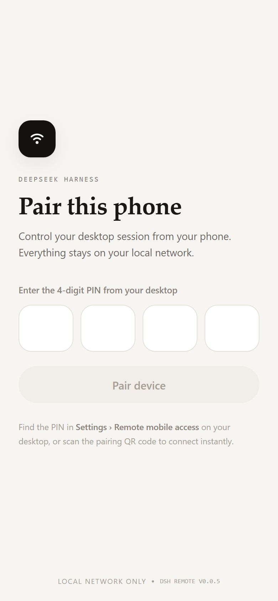
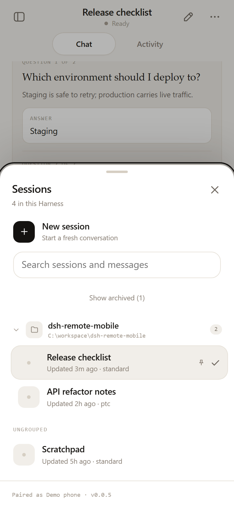
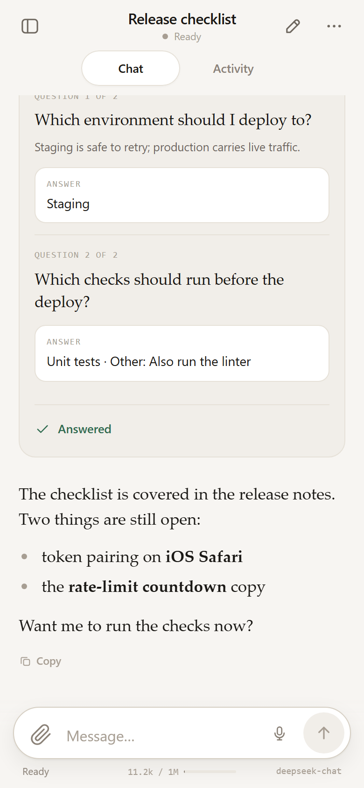
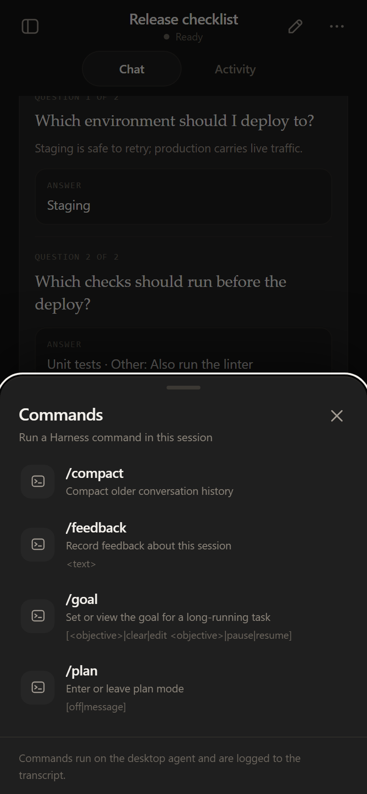

# dsh-remote-mobile

[](https://www.npmjs.com/package/@deep-podder/dsh-remote-mobile)
[](LICENSE)

A [DeepSeek Harness](https://github.com/deepseek-ai) plugin that turns your phone into a
remote control for a live desktop Harness session. A small pairing server runs inside the
Harness Host, serves an installable mobile web app, and bridges the phone to the same
session, streaming, tool and approval pipeline the desktop UI uses.

```
phone browser ──HTTP(S)/WS──► <host>:3456            ──bridge──►  DSH Host services
     ▲                         (pairing, cookie, rate limit)          │
     └──────────── QR / 4-digit PIN from the desktop panel ◄───────────┘
```

No npm dependencies. Plain ESM in the Host plugin, plain browser JavaScript in the SPA, and
one vendored MIT QR encoder.

## Screenshots

Captured from the bundled mock server (demo data, 390×844 @2x). They show the pair-once flow,
the desktop-style project grouping, the chat surface and the Host command palette.

| Pair this phone | Sessions grouped by project |
|:---:|:---:|
|  |  |
| **Chat — light** | **Host commands — dark** |
|  |  |

## What you get

- **Real-time chat** — token streaming, markdown, syntax-highlighted code, stop and steer.
- **Sessions** — list, open, create (with an agent preset, a project shortcut and an optional
  working directory), rename, fork, pin/unpin and archive/unarchive. The list is grouped by
  registered project workspace exactly like the desktop sidebar (collapsible project sections,
  an **Ungrouped** section, pinned rows first) and archived sessions are hidden behind an
  explicit **Show archived** control. Content search when the deployment enables the Host's
  session-query index.
- **Model and preset selection** — switch the session's provider/model/reasoning effort and
  the DSH agent preset from the phone.
- **Host commands** — the phone mirrors the live Agent's command palette (`/compact`,
  `/goal`, `/plan`, `/feedback` and any other Host-registered command). `/export` and
  `/permission` are desktop-only: `/export` downloads a browser-authenticated ZIP, and
  `/permission` changes the session's sandbox/approval preset (including
  `danger-full-access`), so sandbox policy stays a desktop decision. Argument commands open a
  small input sheet; unknown commands are refused.
- **Queue and steer** — watch queued messages, edit or remove them, steer one into the
  running turn, and choose Queue vs Steer for the next send.
- **Approvals and questions** — approvals surface as cards with a bounded, secret-scrubbed
  preview of the command or file write/edit when the bridge saw the tool call; per-device
  "can approve" control lives in the desktop pairing panel. `ask_user_question` renders as a
  native question card and answers the waiting tool.
- **Activity** — live tool cards, and the session's changed files with unified diffs for text
  files (live sessions only).
- **Context meter** — used/window tokens with an estimated badge when the Host has no usage
  sample.
- **Attachments** — camera/library/file uploads, inline images delivered to the model as real
  image content parts, and Android share-sheet text/links into a session.
- **Background notifications (Web Push)** — approvals, questions and finished replies reach
  the phone through its service worker while the app is backgrounded or the screen is off.
  Real RFC 8291 `aes128gcm` payload encryption and RFC 8292 VAPID, implemented in `push.js`
  with no dependencies. Requires a secure context (Tailscale Serve HTTPS or localhost) and
  notification permission.
- **Installable PWA** — manifest, service worker, offline shell (requires a secure context)
  and voice input.
- **App lock** — an optional WebAuthn passkey gate on cold start/inactivity. Client-side
  privacy only; see [SECURITY.md](SECURITY.md).
- **Pairing panel in the desktop UI** — QR code, fallback PIN, expiry countdown, per-device
  approval permission, per-device and global revoke, and an on/off switch for the phone
  server.

## Requirements

- **DeepSeek Harness 0.2.2-rc.1** with the Desktop/Web profile (the desktop pairing panel is
  a client module of the Harness Web UI). Other 0.2.2-rc builds may work; the Host API surface
  this plugin uses is documented in [docs/api-notes.md](docs/api-notes.md).
- **Node 22 or newer** (the Host's runtime; the plugin itself has no npm dependencies and uses
  only `node:` built-ins). `dev/` checks use the built-in `fetch`.
- A phone with a current browser. For use away from the LAN, **Tailscale** (or any HTTPS
  reverse proxy) is strongly recommended; see [Security](#security).
- For **background notifications** a secure context is required: HTTPS (Tailscale Serve or a
  trusted TLS proxy) or `http://localhost`. Plain-HTTP LAN access keeps working but has no
  service worker, so Web Push is unavailable there. The user also has to grant notification
  permission once.

## Install

From npm:

```text
plugin_manager action=install_bundle target=@deep-podder/dsh-remote-mobile
```

Or from a checkout of this folder:

```text
plugin_manager action=install_bundle target=<absolute path to this folder>
```

The bundle inserts one Host row (id `dsh-remote-mobile`, package
`@deep-podder/dsh-remote-mobile`) and one Client module. Enabling or disabling the row is the
on/off switch; `config.enabled: false` skips starting the phone server entirely.

## Pairing quick start

1. The Host generates a **4-digit PIN** (5 minutes) and a one-time **pairing token** (10
   minutes) at startup and after every successful pair.
2. Open **Settings → Remote mobile access** in the desktop Web UI. The panel shows a QR code
   for `http://<lan-ip>:3456/?t=<token>`, the PIN, the address and paired devices. When the
   machine has several interfaces (Wi-Fi, hotspot, Tailscale, WSL) each is offered as a
   selectable chip and the QR follows the selected one.
3. Scan the QR with the phone, or open the address and enter the PIN.
4. Pairing mints an `HttpOnly`, `SameSite=Lax` signed cookie (30 days, `Secure` only over
   TLS). Unauthenticated WebSocket upgrades are refused.

PIN attempts are rate limited per client address: 5 failures in 5 minutes → `429` with a
retry delay. PINs and tokens are never logged.

### Tailscale (recommended off-LAN)

Two options:

- **Plain tailnet IP** — sign in on both devices, pick the `100.x.y.z` chip in the panel.
  There is no public exposure.
- **Tailscale Serve (HTTPS, no inbound port)** — run
  `tailscale serve --bg --https=8443 http://127.0.0.1:3456` once, then write that URL to
  `$DSH_HOME/remote-mobile-state.json.public-url` (or set
  `PA_REMOTE_MOBILE_PUBLIC_URL=https://<node>.<tailnet>.ts.net:8443`) and restart the plugin.
  The panel advertises that HTTPS URL, the QR encodes it, the cookie is issued over TLS, and
  the service worker, app lock and background Web Push become available. Serve proxies both
  HTTP and the WebSocket.

## Configuration

```yaml
- id: dsh-remote-mobile
  name: 'dsh-remote-mobile'
  config:
    enabled: true      # false unloads the server and the desktop pairing panel
    host: '0.0.0.0'    # bind all interfaces so LAN/Tailscale devices can reach it
    port: 3456         # 0 picks a free port
```

Environment overrides (all optional):

| Variable | Meaning |
|---|---|
| `PA_REMOTE_MOBILE_PUBLIC_URL` | HTTPS origin advertised by the pairing panel/QR when a reverse proxy (Tailscale Serve) fronts the server. |
| `PA_REMOTE_MOBILE_PUSH_HOSTS` | Comma-separated extra push-service host suffixes for a self-hosted relay. Known provider hosts (FCM/APNs/Mozilla/WNS) are always accepted; arbitrary endpoints are refused. |
| `PA_REMOTE_MOBILE_VAPID_SUBJECT` | VAPID `sub` contact sent to the push service (defaults to a placeholder `mailto:`; set a real contact for a long-lived deployment). |

The pairing panel's **Remote access** switch closes/reopens the listener and every mobile
WebSocket without discarding paired devices or the bridge. The choice persists in
`$DSH_HOME/remote-mobile-state.json.enabled`. Turning it off while a phone is connected asks
for confirmation first.

State lives in `$DSH_HOME/remote-mobile-state.json` (mode 0600), falling back to
`~/.dsh/remote-mobile-state.json` when a desktop-launched Host does not export `DSH_HOME`. The
same file holds the VAPID key pair and the per-device push subscriptions under `push`; the
private key never leaves that file, and unpairing/revoking a device deletes its subscriptions.
A per-process desk key is written beside it as `remote-mobile-state.json.desk-key` so local
tooling can read pairing status; the key alone grants nothing over the network. When no state
directory exists the plugin runs memory-only.

## Security

Pairing is the trust boundary: a paired phone is treated as the same user as the desktop. Use
a trusted LAN or a tailnet, and do not expose the mobile port to the public internet. The full
threat model, cookie/approval rules, LAN HTTP risks, upload containment and the
revoke/rotate procedures are in [SECURITY.md](SECURITY.md).

Highlights:

- One-time token/PIN pairing, HMAC-signed `HttpOnly` cookie, constant-time secret comparison,
  per-address PIN rate limiting.
- Desktop pairing data only answers a loopback peer or the per-process desk key; remote
  origins get `403`.
- Approval routing is exclusive to the connected phone, with a desktop dock on the same
  pending list; first answer wins, and a device marked `canApprove: false` cannot answer.
- Uploads are capped at 32 MiB and confined to the session's
  `var/remote-mobile-uploads`; previews refuse arbitrary paths.
- The phone server serves a strict CSP, `nosniff`, referrer/permissions headers and no
  third-party assets.

## Known limitations

- **Approval routing is exclusive to whichever side is attached.** While a phone client is
  connected the phone answers Host approval requests (the desktop gets a plugin-rendered dock
  on the same pending list, so either device can answer and the first answer clears both).
  With no phone connected, requests go straight to the shipped desktop answerer.
- **Questions have a narrower safety net.** While a phone is connected it is the exclusive
  answerer, like approvals. If no phone is connected when a question is asked, the bridge
  waits up to 45 seconds for a phone to (re)connect, then hands the question to the desktop
  card. A phone that disconnects after receiving a question does not trigger that handoff.
- **Content search depends on the deployment.** When the Host disables its session-query
  index, `sessions.search` reports `unavailable` and the phone falls back to filtering the
  loaded session list; the UI hides search where the deployment reports it disabled.
- **File diffs are live-process only.** Change summaries live in Host memory for recorded
  sessions; after a Host restart or for a cold/foreign session the phone shows "diff
  unavailable" while the durable event stays listed.
- **The command palette mirrors the live Agent registry.** Commands are read from the Host
  registry mounted for the session's Agent preset (so a preset that omits a command hides it
  here too), and only live sessions can list or run them — a cold session answers
  `available:false`. Two commands stay desktop-only: `/export` (the ZIP is produced by a
  browser-authenticated Host route) and `/permission` (it switches the sandbox/approval preset,
  including `danger-full-access`, so it must not be changed from a device that may itself lack
  approval rights). Commands that accept attachments are run without attachments from the
  phone; use the composer for files.
- **Background notifications need a secure context, permission and a browser push service.**
  Web Push works over HTTPS (Tailscale Serve or a trusted TLS proxy) or `localhost`; plain-HTTP
  LAN access has no service worker. The user must grant notification permission once, and the
  phone must have a working browser push service (FCM on most Android builds, Apple push on
  iOS 16.4+ installed web apps; known provider hosts are required — self-hosted relays opt in
  with `PA_REMOTE_MOBILE_PUSH_HOSTS`). Subscriptions expire and the SPA re-subscribes on start.
  While any phone page is in the foreground the Host sends no push; delivery is capped at
  ~30/min and deduplicated by tag. A finished-reply push carries the session title plus the
  first ~150 characters of the assistant reply, so lock-screen notifications can show
  conversation content — approval/question pushes are bounded and secret-scrubbed, and the
  reply excerpt is flattened plain text.
- **The app lock is a client-side deterrent, not server enforcement.** WebAuthn needs a
  secure context (Tailscale Serve HTTPS or localhost). A determined attacker with the unlocked
  phone and developer tools can bypass the JS gate; the authoritative protection is the
  paired-device cookie plus desktop revoke.
- **Image inlining has limits** (byte/dimension/count caps advertised by the Host,
  png/jpeg/webp/gif only). Unsupported or unreadable images degrade to file-path attachments
  so a send never fails.
- **The phone cannot delete or reorder sessions**, and there is no terminal, file browser,
  plugin manager or settings editor — the phone covers the conversation surface, not the
  whole desktop application.
- **Single Harness Host**: one process, one mobile server; multiple phones share the same
  session set.
- **Plain HTTP on the LAN is not private.** Use Tailscale, a trusted Wi-Fi network, or TLS in
  front of the port.
- **Unpaired clients can read `/api/health` and `/api/state`** (version and
  paired/not-paired state only; no secrets).

## Development

All checks are deterministic and run without a Host unless labelled *live*:

```text
node --check server.js && node --check bridge.js && node --check auth.js
node --check index.js  && node --check client.js && node --check qr.js && node --check push.js
node dev/server-smoke.mjs        # transport: pairing, cookies, rate limit, desktop API, WS, approvals, push surface
node dev/push-check.mjs          # Web Push wire proof: RFC 8291 Appendix A vector, VAPID JWT verify, aes128gcm decrypt, pruning, caps, logs
node dev/static-check.mjs        # served SPA files, headers/CSP, PWA surface, share target
node dev/client-check.mjs        # executes the browser half against a fake loader/React shim
node dev/desk-auth-check.mjs     # desktop endpoint loopback/key policy and same-origin route
node dev/toggle-check.mjs        # on/off switch closes and reopens the listener
node dev/changes-bridge-check.mjs# context meter, changed files/diffs, command palette, project mapping
node dev/spa-check.mjs           # SPA helper/id/version consistency (reads mobile/)
node dev/release-check.mjs       # package files completeness + public-release invariants
node dev/ui-check.mjs            # live: project grouping, archived filter, command palette (headless Chrome)
node dev/capture-screenshots.mjs # regenerates docs/screenshots from the mock server (headless Chrome)
```

`dev/*-live.mjs` scripts pair a real device and create sessions against an installed plugin;
they are manual probes for a development Host, not CI checks, and they must not be run
against a Host you are not prepared to mutate. `dev/model-effort-live.mjs` additionally
verifies the reasoning-effort catalog/selection round-trip without spending model tokens.
`dev/ui-check.mjs` is a live check too: it pairs a temporary device, installs its cookie in
headless Chrome, and asserts the project-grouped Sessions sheet, the archived filter and the
command palette end to end (it needs the installed plugin and Chrome; `CHROME_PATH` and
`CDP_PORT` override the defaults, and it revokes its device afterwards).

Web Push has also been confirmed on hardware: with the plugin installed and the phone
backgrounded, `POST /api/push/test` delivered through FCM, the service worker reported
`push-shown` in the Host debug log, and the notification appeared on the phone. The
`aes128gcm` body is pinned byte-for-byte against the RFC 8291 Appendix A vector so an
interoperable-but-wrong encryption cannot regress silently.

`mobile/mock-server.js` is a development-only mock of the phone API and WebSocket protocol,
useful when iterating on the SPA without DSH. It mirrors the current (v20) `workspaces`,
`workspaceId` and command-palette frames, so the project-grouped sessions sheet and the
Commands sheet can be exercised without a Host. `node dev/capture-screenshots.mjs` drives that
mock in headless Chrome and refreshes the images above.

## Releasing

The package publishes publicly to npm as
[`@deep-podder/dsh-remote-mobile`](https://www.npmjs.com/package/@deep-podder/dsh-remote-mobile)
(`publishConfig.access: public`). Before `npm publish`:

1. `node dev/release-check.mjs` — verifies the `files` list covers every runtime asset,
   `README` screenshots are present, the version agrees everywhere, `/permission` stays
   hidden from the phone, and no personal paths leak into published files.
2. `npm pack --dry-run` — review the tarball contents.
3. `npm login` (once) and `npm publish` from this folder. The package has no build step and
   no dependencies, so the published files are the tracked source.

Version bumps touch `package.json`, `index.js`, `server.js`, `mobile/app.js`
(`FALLBACK_VERSION`) and the PROTOCOL example; `release-check` enforces that they agree.

## Documentation

- [npm package](https://www.npmjs.com/package/@deep-podder/dsh-remote-mobile) ·
  [source on GitHub](https://github.com/unknown-spec10/dsg-remote-mobile) ·
  [issues](https://github.com/unknown-spec10/dsg-remote-mobile/issues)
- [PROTOCOL.md](PROTOCOL.md) — authoritative HTTP/WebSocket wire contract.
- [SECURITY.md](SECURITY.md) — threat model and revocation/rotation procedures; report
  vulnerabilities through the repository's private advisory form.
- [docs/api-notes.md](docs/api-notes.md) — verified DeepSeek Harness Host API notes behind the
  bridge (v1 surface).
- [docs/api-notes-v2.md](docs/api-notes-v2.md) — the v2 feature-API research (session
  management, queue, diffs, context, commands, attachments).
- [docs/verification.md](docs/verification.md) — internal maintainer verification log kept for
  release evidence; not part of the public contract.
- [mobile/README.md](mobile/README.md) — mobile SPA implementation notes and design decisions.

## License

MIT — see [LICENSE](LICENSE). The vendored QR encoder is MIT (Kazuhiko Arase), attribution in
`vendor/LICENSE`.
